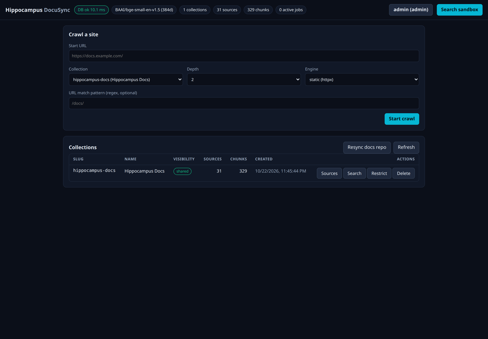

# Hippocampus

A small self-hosted memory service: it stores documents (web pages you crawl, Markdown you push, repositories) as
searchable chunks in PostgreSQL with pgvector and answers **semantic searches** ("how do we handle database
backups?") instead of keyword matches. It has a REST API, an MCP server for AI assistants, and a web dashboard.
Everything runs on your own machine; nothing is sent to a cloud service.

> [!NOTE]
> This application is still under development and currently in beta. Expect rough edges and changes between releases.



> [!IMPORTANT]
> **Crawling copies other people's content.** Before you point the crawler at a site, read
> [Legal and ethical use of the crawler](docs/User_Guide/legal-and-ethics.md): what it honours (`robots.txt`), what it does **not** (`Crawl-delay`, meta robots,
> `X-Robots-Tag`, usage terms), and a checklist. You are responsible for what you crawl and store. This is general information, not legal advice.

- **Local embeddings:** `BAAI/bge-small-en-v1.5` (384 dimensions) runs on your CPU, baked into the image.
- **Collections with access control:** a collection is *shared* (readable by every caller) or *restricted* (only by
  access tokens you grant). Tokens are named accounts with read/write grants; only a hash is stored.
- **Dashboard:** crawl a site, browse sources, try searches, manage collections and accounts.
- **MCP:** a `hippocampus_search` tool (and an optional indexing tool) for MCP-capable assistants.
- **Responsible crawling:** the [legal and ethics guide](docs/User_Guide/legal-and-ethics.md) says what the crawler does and does not honour.

## Quick start

You need Docker (with the compose plugin) or Podman (with `podman compose`), and `bash` (on Windows: Git Bash or WSL). To see what your
machine is missing, run `scripts/prereqs.sh` (macOS/Linux) or `.\scripts\prereqs.ps1` (Windows PowerShell): it only looks, lists what to
install and why, and installs nothing unless you pass `--install` and answer y/N to each item.

```bash
git clone <this repository> hippocampus && cd hippocampus
./hippocampus up
```

The first run creates `hippocampus.env` with a random database password, builds the image (a few minutes: it
downloads the embedding model), starts PostgreSQL and the API, applies the database migrations, and creates the
first admin account. **Its token is printed once, so copy it now.** Then open <http://127.0.0.1:8090/ui/>, click
`anonymous` in the header, and paste the token.

Other commands: `./hippocampus status`, `logs`, `down` (keeps your data), `reset` (deletes everything, asks first),
and `./hippocampus admin ...` for the account tool (`list-clients`, `create-client`, `rotate-client`, `revoke-client`).

## Using it

1. In the dashboard, **crawl** a documentation site into a new collection (the *static* engine is the default).
2. Use the **search sandbox**, or call the API:

   ```bash
   curl -s http://127.0.0.1:8090/v1/search -H 'Content-Type: application/json' \
     -d '{"query": "how do I configure the proxy?", "top_k": 5}'
   ```

3. Index your own Markdown: `POST /v1/ingest/file` with `{"collection": "...", "uri": "notes/a.md", "text": "..."}`.
4. Give a tool its own limited account: `./hippocampus admin create-client --name notes-reader --read my-notes`.

With `HIPPO_REQUIRE_AUTH=true` (the default) every write needs a token; reading shared collections stays open.
**Restricted** collections are invisible without a grant: an unscoped search never returns them and a named search
answers 404. Create one in the dashboard (admin token) or with `POST /v1/collections` and `"visibility": "restricted"`.

### MCP (for an AI assistant)

```bash
pip install -e ".[mcp]"   # in a virtualenv
HIPPO_URL=http://127.0.0.1:8090 HIPPO_TOKEN=<a token with read access> HIPPO_MCP_READONLY=1 python -m hippocampus.cli.mcp_server
```

`HIPPO_MCP_READONLY=1` leaves out the indexing tool, which reads local files; use it wherever a model chooses the tools.
Step-by-step setup for Claude Code, OpenCode and Antigravity (`agy`) is in [docs/Mcp/connecting-assistants.md](docs/Mcp/connecting-assistants.md).

## Documentation

The full guide and reference are in [`docs/`](docs/Index.md): a user guide (install, dashboard, access control, ingesting,
searching, configuration, operations, troubleshooting) and a technical reference (architecture, HTTP API, database, MCP).

### Search the docs with Hippocampus itself

The docs are Markdown, so Hippocampus can index them and answer questions about itself:

```bash
./hippocampus up                               # first run only: copy the admin token it prints
export HIPPO_TOKEN=hip_...                     # the admin token (or an account with write access)
scripts/index_docs.py --plan                   # list the files that would be indexed; sends nothing
scripts/index_docs.py                          # index docs/ into the collection "hippocampus-docs"
```

The script creates the collection if needed (shared; `--restricted` makes it restricted), pushes every `*.md` under `docs/`, and
prints what it added or changed. Run it again after you pull new docs: unchanged files are skipped, so only edited ones are
re-embedded. It never deletes anything (a removed page stays until the collection is deleted). Without `HIPPO_TOKEN` it asks for
the token, hidden. Then search from the dashboard's **Search sandbox**, or:

```bash
curl -s http://127.0.0.1:8090/v1/search -H 'Content-Type: application/json' \
  -d '{"query": "how do I make a collection private?", "collections": ["hippocampus-docs"], "top_k": 3}'
```

## Configuration

Everything is in `hippocampus.env` (see `hippocampus.env.example`): the port and bind address (default
`127.0.0.1`, this computer only), `HIPPO_REQUIRE_AUTH`, the allowed client networks, crawler limits, and
`HIPPO_INSTALL_BROWSER=1` to build with Chromium so the crawler's *browser* engine can render JavaScript-only sites.
After editing, run `./hippocampus up` again.

## Safety notes

- The service is meant for your own machine or a trusted network. Keep `HIPPO_BIND=127.0.0.1` unless you know why not;
  if you expose it, put a reverse proxy with TLS and your own login in front of it.
- Crawled web content is untrusted data. The crawler refuses private and local addresses, and the dashboard shows
  everything as plain text, never HTML.
- Tokens are shown once when created and cannot be recovered; rotate or replace an account if one is lost.
- Back up the database with, for example,
  `docker compose --env-file hippocampus.env exec postgres pg_dump -U hippocampus hippocampus > backup.sql`
  (use `podman compose` if that is your engine).

## Development

```bash
python -m venv .venv && .venv/bin/pip install -e ".[db,api,mcp,dev]"
scripts/check.sh            # migrations from zero, the test suite, the dashboard JavaScript (starts a throwaway test database in a container)
scripts/check.sh --no-db    # unit tests only
scripts/smoke_live.py       # end-to-end check of a running instance (asks for an admin token, leaves nothing behind)
```

`scripts/check.sh` and `scripts/lint.sh` only start `scripts/check.py` and `scripts/lint.py`; on Windows run `python scripts/check.py` instead.
`.github/workflows/ci.yml` runs the same checks on every push and pull request. Claude Code users: the repository ships hooks that guard the local
data and the token files and check each edit ([docs](docs/Development/claude-code-hooks.md)).

## Contributing

Issues and pull requests are welcome: see `CONTRIBUTING.md` (set-up, the checks to run, how review works). This repository is
generated from the maintainer's private upstream; a merged pull request is imported there with your authorship kept, so the
next sync carries it forward.

## License

MIT, see `LICENSE`.
