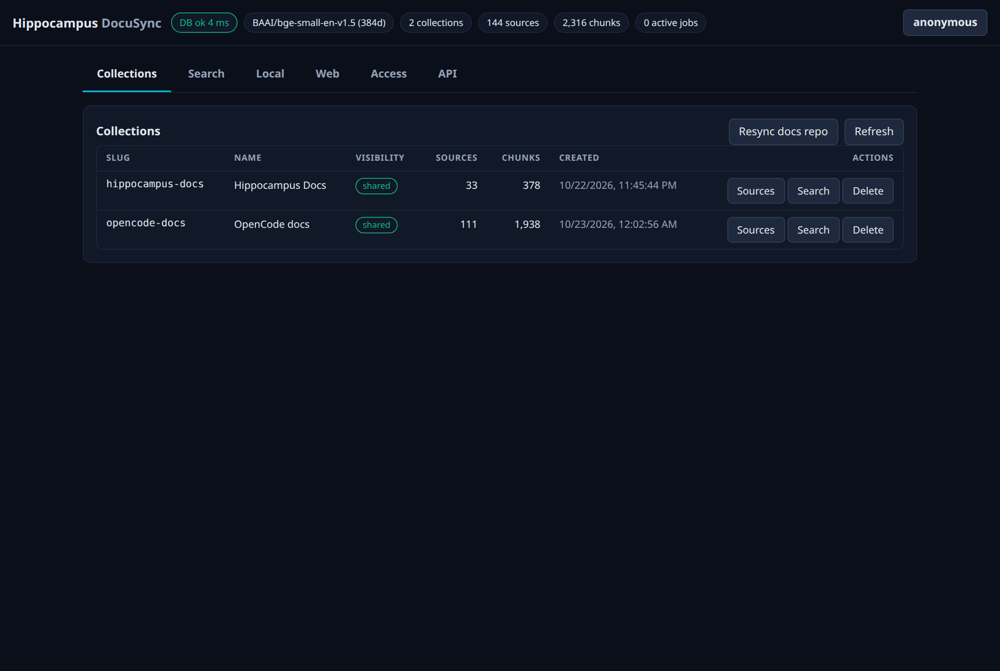
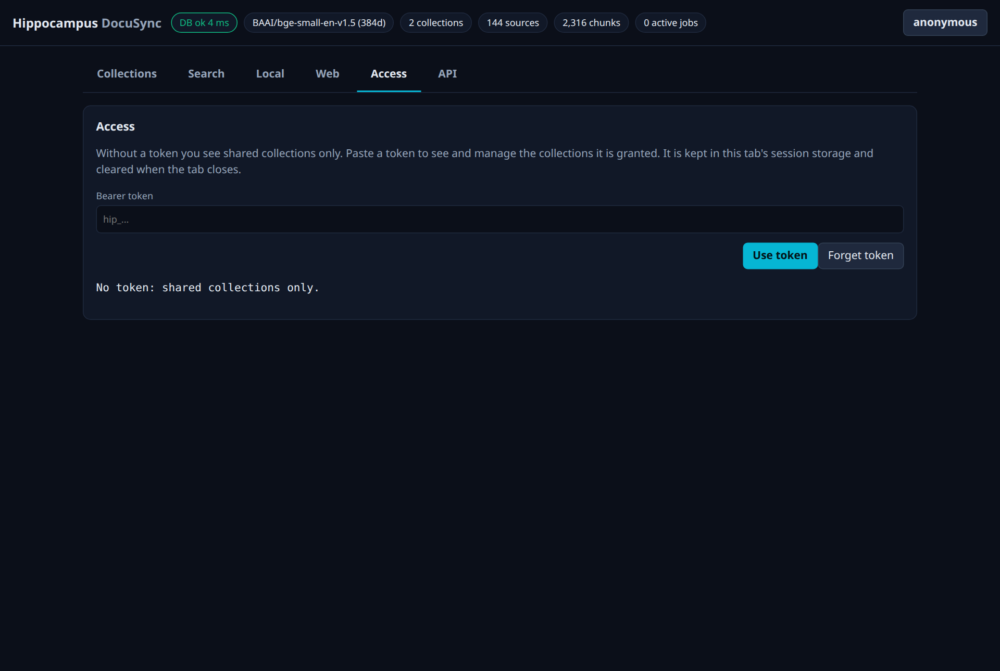
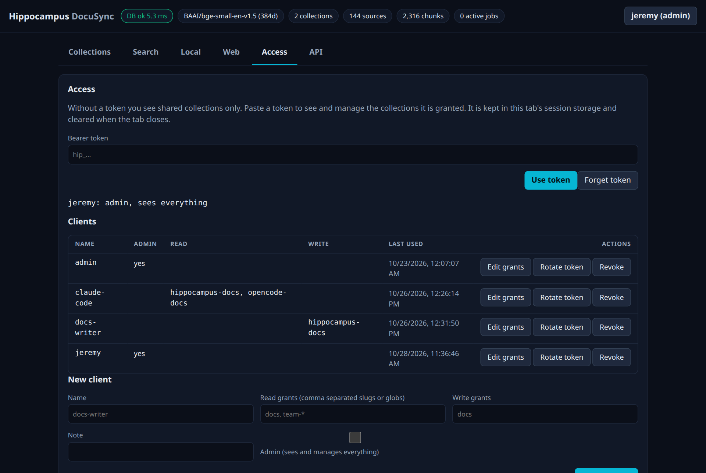
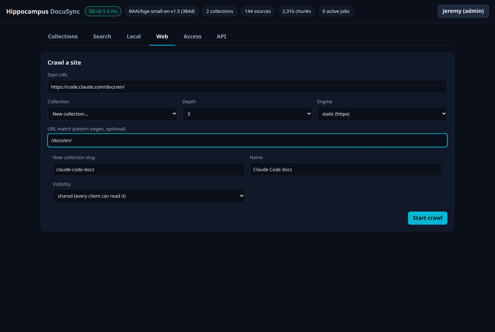
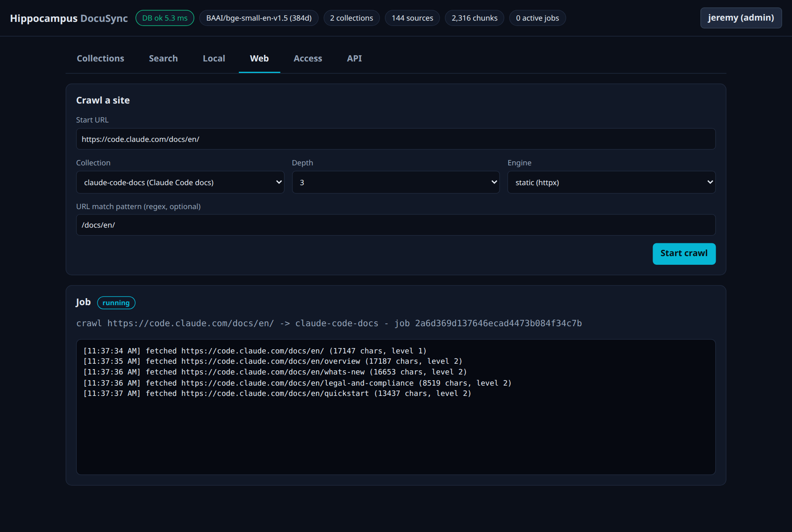
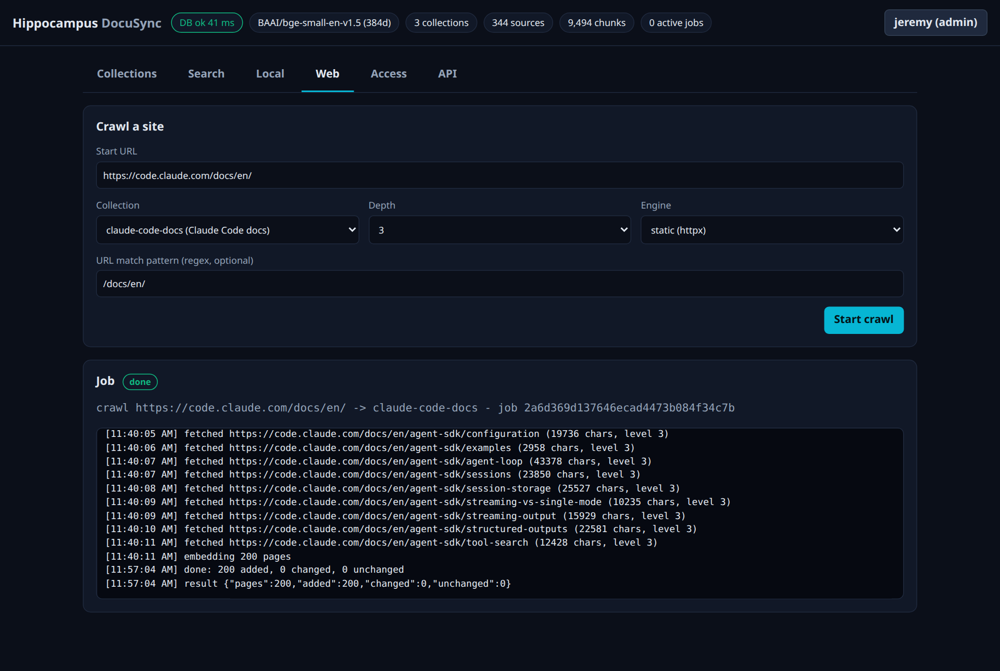
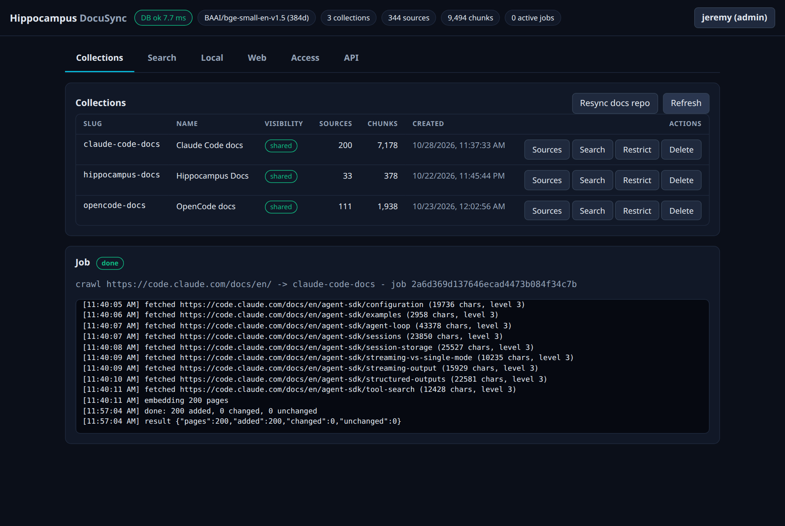
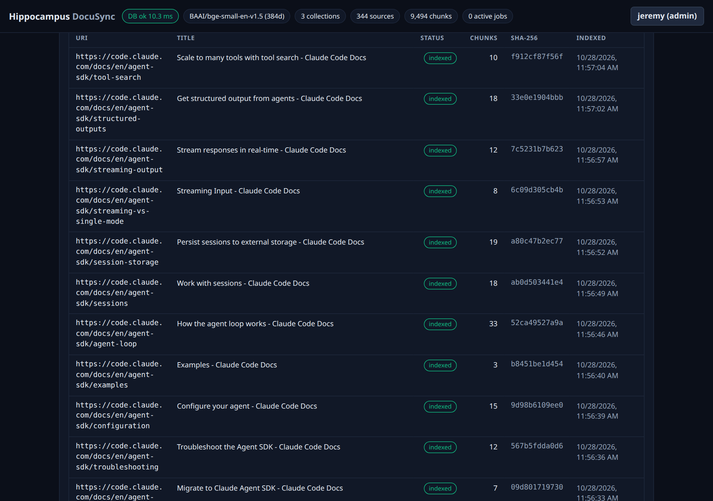
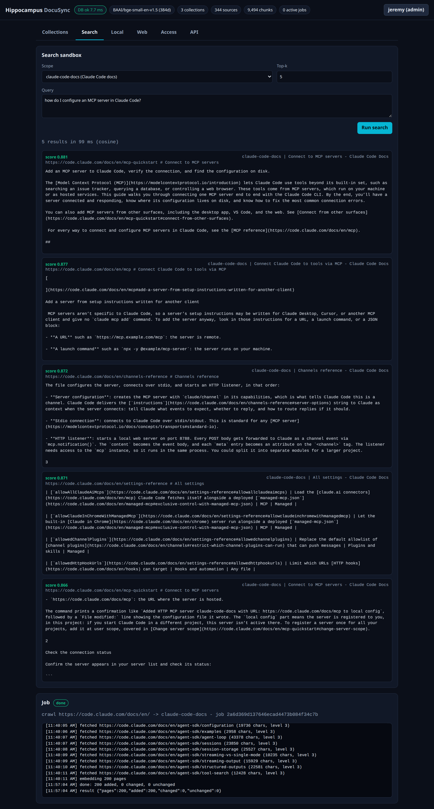

# Crawl and index a documentation site, step by step

This guide takes one real site, the Claude Code documentation at <https://code.claude.com/docs/en/>, from nothing to a searchable
collection. It uses the dashboard, then shows the command-line and assistant shortcuts that do the same job. The screenshots are from a
real run on a local stack; page counts, scores and times will differ a little on your machine.

What you will end up with: a collection called `claude-code-docs` holding the site's pages as searchable passages, and the means to repeat
the job for any other documentation site.

This is a living document. It describes the code as of migration `0002_access_control`; update it alongside the source.

## Before you start

1. **Hippocampus is running.** `./hippocampus status` answers, and <http://127.0.0.1:8090/ui/> opens the dashboard. If not, see
   [getting-started.md](getting-started.md).
2. **You have a token that can write.** An admin token works; so does an account with a write grant on the collection. Tokens are shown
   once, when an account is created or rotated ([collections-and-access.md](collections-and-access.md)). Keep yours in a git-ignored file
   such as `token.env`, never in a file that is committed.
3. **You are allowed to crawl the site.** The crawler copies other people's content. Read [legal-and-ethics.md](legal-and-ethics.md), then
   check the two things software cannot check for you: the site's terms of use, and `robots.txt`. For this site:

   ```bash
   curl -s https://code.claude.com/robots.txt
   ```

   ```text
   User-agent: *
   Content-Signal: ai-train=yes, search=yes, ai-input=yes
   Disallow: /cdn-cgi/
   Allow: /_next/image
   Disallow: /_next/
   Sitemap: https://code.claude.com/docs/sitemap.xml
   ```

   Only `/cdn-cgi/` and `/_next/` are disallowed, so `/docs/en/` is open to the crawler, and the site states that search and AI-input use is
   allowed. The crawler honours these rules, but **not** `Crawl-delay`, `noindex` or `X-Robots-Tag`, so a site that uses those to opt out
   should not be crawled.

## Step 0: probe the site (optional, recommended)

A probe makes a handful of polite requests (`robots.txt`, the start page, up to two sitemaps) and tells you what a crawl would meet, before you
spend minutes on it. From the command line:

```bash
scripts/crawl_site.py https://code.claude.com/docs/en/ --collection claude-code-docs --plan
```

For this site it reports:

| Finding | Value | What it means |
|---|---|---|
| robots.txt | found, start URL allowed | The crawler may fetch it |
| Start page | HTTP 200, about 2,000 words, 58 same-host links | A normal page: the plain `static` engine is enough |
| Sitemap | 2,713 URLs, 227 under `/docs/en/` | The part you want is bigger than the page cap |
| Suggested | engine `static`, depth 3, pattern `/docs/en/` | The settings used in the steps below |
| Warning | "the sitemap lists 227 matching pages and the cap is 200" | The crawl will stop at 200 pages |

The probe is also available to scripts and assistants as `POST /v1/crawl/probe`
([../Api/endpoints.md](../Api/endpoints.md#post-v1crawlprobe--200)). Its numbers are estimates from the start page and the sitemap only.

## Step 1: sign in to the dashboard

Open <http://127.0.0.1:8090/ui/>. Without a token the header says `anonymous` and you can only see shared collections.



Open the **Access** tab, paste your token into **Bearer token** (the field hides it) and press **Use token**.



The header now shows your account name, for example `jeremy (admin)`, and the **Clients** table appears. The token stays in this browser tab's
session storage and is gone when you close the tab.



## Step 2: fill in the crawl form

Open the **Web** tab and fill in **Crawl a site**:

| Field | Value | Why |
|---|---|---|
| Start URL | `https://code.claude.com/docs/en/` | Where the crawl begins; it never leaves this host |
| Collection | **New collection...** | Reveals the three fields below |
| New collection slug | `claude-code-docs` | The identifier: lowercase letters, digits and dashes, up to 64 |
| Name | `Claude Code docs` | The display name |
| Visibility | `shared` | Every client can read it. Choose `restricted` (admin token) to hide it from everyone without a grant |
| Depth | `3` | 1 is the start page only; 2 adds the pages it links to; 3 adds the pages they link to |
| Engine | `static (httpx)` | Plain HTTP. Use `browser` only for sites that build their pages with JavaScript |
| URL match pattern | `/docs/en/` | A regular expression: only links containing it are followed, which keeps the crawl inside the English docs |



## Step 3: start the crawl and watch the log

Press **Start crawl**. A **Job** section appears with a status badge and a live log. The crawler fetches one page at a time with a half-second
pause (`HIPPO_CRAWL_DELAY`), follows links breadth first, and stops at 200 pages (`HIPPO_CRAWL_MAX_PAGES`).



Each line shows the page address, how much text it yielded and its level (1 is the start page). Lines like `skip (robots.txt) <url>` or
`refused <url>` mean the crawler declined a page on purpose. You can leave this tab: the job keeps running and the header counts it under
**active jobs**.

## Step 4: wait for indexing to finish

After the last page is fetched the log says `embedding 200 pages`. Each page is cut into passages at its headings and each passage is turned
into a vector by the embedding model on your CPU. **This is the slow part**: in this run fetching took about three minutes and embedding about
seventeen. The dashboard stays usable meanwhile.

The job ends with a result line and a green **done** badge:



`200 added, 0 changed, 0 unchanged` is the outcome. If you crawl the same site again later, pages whose text has not changed are skipped
(`unchanged`) and not embedded again, so a re-crawl is much quicker. A job that fails ends with an **error** badge and the reason; the
collection keeps whatever it had before.

## Step 5: check the collection

Open the **Collections** tab. The new collection appears with its source and chunk counts:



A **source** is one page; a **chunk** is one searchable passage (about 36 per page here). Press **Sources** on the row to list the pages: the
address, title, status (`indexed`), chunk count, the first characters of the content hash and when each was indexed.



## Step 6: ask a question

Open the **Search** tab, choose `claude-code-docs` as the **Scope**, type a question as a full sentence and press **Run search**.



Each result shows its score (closeness of meaning, up to 1; about 0.6 and above is usually a good match), the collection, the source address,
the heading it sits under and the passage. Here the top two results are the MCP quickstart (0.881) and the MCP reference page (0.877). If a
question finds nothing useful, try the words the page would use ([searching.md](searching.md#asking-good-questions)).

## Doing the same without the dashboard

**From the command line.** The script probes, asks you to confirm, creates the collection, crawls, streams the log and checks the result:

```bash
scripts/crawl_site.py https://code.claude.com/docs/en/ --collection claude-code-docs --name "Claude Code docs" \
  --query "how do I configure an MCP server in Claude Code?"
```

The token comes from `HIPPO_TOKEN`, or from a named variable in `token.env` (`--token-var HIPPO_TOKEN_ADMIN`), or is typed hidden. Add
`--plan` to stop after the probe, `--yes` to skip the confirmation, and `--depth`, `--pattern` or `--engine` to override the suggestions.

**From Claude Code.** The `/crawl` command in this repository asks the same questions, runs the probe and the script, and checks the result
with two searches.

**Through the API.** `POST /v1/collections`, then `POST /v1/crawl`, then `GET /v1/jobs/<id>/events` for the log
([ingesting.md](ingesting.md#crawling-a-site)).

## What to know about the result

- **The 200-page cap.** The sitemap lists 227 pages under `/docs/en/`, so about 27 pages were not crawled. The crawl is breadth first, so
  the pages missing are the deepest ones. To cover more, narrow the pattern to a sub-path (for example `/docs/en/agent-sdk/`) and crawl
  again into the same collection, or raise `HIPPO_CRAWL_MAX_PAGES` in `hippocampus.env` if you are sure the site can take it.
- **Crawls never remove pages.** A page that disappears from the site stays in the collection. To start clean, delete the collection
  (Collections table, **Delete**) and crawl again.
- **Duplicates.** A page linked both with and without a trailing slash can be stored twice. It is harmless to answers but wastes space.
- **Keep it private.** The pages are copies of someone else's work: do not republish them, credit the source address when you quote a result,
  and delete the collection if the owner asks.
- **Give an assistant read-only access.** Create an account with a read grant on the collection and no write grant:
  `./hippocampus admin create-client --name claude-docs-reader --read claude-code-docs`, then connect it as in
  [../Mcp/connecting-assistants.md](../Mcp/connecting-assistants.md).

## Troubleshooting

| Symptom | Cause and fix |
|---|---|
| The **Start crawl** button answers `403` | The token has no write grant on that collection. Use an admin token or add a grant |
| `refused <url>: ... non-public address` | The crawler never fetches local, private or VPN addresses, by design |
| The job finishes with very few pages | The site probably builds its pages with JavaScript. Run the probe: if it recommends `browser`, the image must be built with `HIPPO_INSTALL_BROWSER=1` |
| Results are weak (scores well under 0.6) | The question and the page use different words, or the page was not crawled: check **Sources** |
| Every request answers "the database is busy" | The API cannot reach the database. See the DNS entry in [troubleshooting.md](troubleshooting.md#indexing) |

More symptoms and fixes: [troubleshooting.md](troubleshooting.md).
