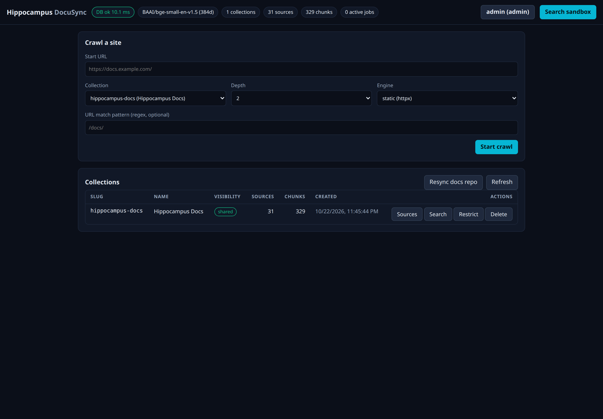

# The dashboard

The dashboard is a single web page served by the API itself at `/ui/` (the root address `/` redirects there). There is
nothing to install and it makes no requests to any other site: scripts, styles and fonts all come from the service.
For how it is built, see [../Dashboard/README.md](../Dashboard/README.md). For screenshots of a complete run (crawl, then search), see
[walkthrough.md](walkthrough.md).



## Layout

```
┌ Hippocampus DocuSync  [status pills]            [identity button]  ┐
│ [banner: errors appear here]                                                        │
│ [ Collections ] [ Search ] [ Local ] [ Web ] [ Access ]                             │
│                                                                                      │
│ Collections: the collections table, and Sources in <collection> after you click it  │
│ Search:      the search sandbox                                                      │
│ Local:       Index a folder (drop zone, tree, rules, preview), and Saved folders    │
│ Web:         Crawl a site                                                           │
│ Access:      token, identity and clients                                            │
│                                                                                      │
│ Job log                 (below the tabs; appears while or after a job runs)          │
└──────────────────────────────────────────────────────────────────────────────────────┘
```

The five tabs split the page by what you are doing. The address keeps the tab (`/ui/#local`), so a reload or a bookmark returns
to it, and the left and right arrow keys, **Home** and **End** move between tabs. The identity button in the header jumps to
**Access**. The job log is not part of a tab, so a crawl or a resync keeps reporting while you look at another tab.

## Status pills

Updated every 15 seconds and after every action:

| Pill | Meaning |
|---|---|
| `DB ok 9.3 ms` | The database answered; the number is the round-trip time. If the API cannot be reached the pill reads `API unreachable`. |
| `BAAI/bge-small-en-v1.5 (384d)` | The embedding model and its vector size. Fixed. |
| `N collections`, `N sources`, `N chunks` | Totals **for the collections you may read**. A restricted collection you cannot see is not counted. |
| `N active jobs` | Crawls and imports currently running. |

## Access tab

Click the identity button in the header (it reads `anonymous` until you sign in).

- **Bearer token** and **Use token**: paste a `hip_...` token to act as that account. **Forget token** signs out. The
  token lives in the browser tab's session storage only; closing the tab forgets it. The dashboard sends it in an
  `X-Hippo-Token` header.
- The line under the form says who you are: `No token: shared collections only`, or the account name with its grants,
  or `admin, sees everything`.
- **Clients** (admin only): a table of accounts with their grants and when each was last used. Revoked accounts stay in
  the list, marked `revoked`.
  - **Edit grants** asks for the read and write grants as comma-separated slugs or wildcards.
  - **Rotate token** issues a new token for the same account and name, and the old token stops working immediately. If
    you rotate the token you are signed in with, the tab switches to the new one automatically.
  - **Revoke** disables the account for good. The last active admin cannot be revoked.
- **New client** (admin only): name, read grants, write grants, a note and an **Admin** checkbox. The new token is shown
  once, in a box with the note "shown once and only its hash is stored". Copy it before you click **I have stored it**.

## Index a folder

Drop a folder on the dashed box (or press **Choose folder**) to index notes, docs or code from your own machine. The browser reads
the folder; nothing is uploaded until you press **Index these files**, and only the files that pass the rules are sent.

1. **Folders.** The top-level folders are listed with how many files each would index. Everything is ticked except folders that look
   private (`Journal`, `Personal`, `Private`, ...). `.git`, `node_modules` and the like are never read.
2. **Where it goes.** Pick a collection or create one, or tick **One collection per root folder** to give each folder its own
   collection (and its own visibility, so `Work` can be shared and `Personal` restricted). Files at the top of the folder go to the
   collection chosen above.
3. **Rules.** Optional include and exclude lines (gitignore style), the file types (default `md, markdown, txt, rst`), the default
   exclusions, and the folder's own `.gitignore` if it has one. The **Preview** updates as you type: how many files will be
   indexed, how many are skipped and why, and which are rejected. **Check with server** asks the server the same question.
4. **Import once** or **Save as a source.** A saved source remembers the rules and folders; it appears under **Saved folders**.
5. **Index these files.** A progress bar runs and **Cancel** stops it without removing anything. The summary lists what was added,
   changed, removed, skipped and rejected. Rejected files are named with the rule, never the content. A file that now holds a secret
   is removed from the index.

To refresh, press **Drop again** on a saved folder and drop it; only changed files are embedded again and files that are gone are
removed. Chromium-based browsers remember the folder and offer **Re-sync** for one-click refresh after asking for permission. Unticking
a folder and running again removes its files. **Forget** removes the saved source, and optionally the files it indexed.

## Crawl a site

Fetches a site and indexes its pages into a collection. **Only crawl sites you have the right to copy:** read [legal-and-ethics.md](legal-and-ethics.md) first. See [ingesting.md](ingesting.md#crawling-a-site) for what the
crawler does and refuses.

| Field | Meaning |
|---|---|
| **Start URL** | An `http` or `https` address. Private, local and VPN addresses are refused. |
| **Collection** | An existing collection, or **New collection...**, which reveals a slug, a name and a visibility choice. Creating a *restricted* collection needs an admin token. |
| **Depth** | 1 = the start page only; 2 = it and the pages it links to; 3 and 5 go further. Links are followed only on the same host. |
| **Engine** | `static` (plain HTTP, the default) or `browser` (headless Chromium, for sites that need JavaScript; only available if the image was built with `HIPPO_INSTALL_BROWSER=1`). |
| **URL match pattern** | An optional regular expression; only links whose address matches are followed. For example `/docs/`. |

Click **Start crawl**. The **Job** section appears with a status badge (`running`, `done`, `error`) and a live log, for
example `fetched https://docs.example.com/ (4210 chars, level 1)` and, at the end, `done: 12 added, 0 changed, 0 unchanged`.

## Collections

| Column | Meaning |
|---|---|
| Slug, Name | The collection's identifier and its display name. |
| Visibility | `shared` or `restricted`. |
| Sources, Chunks | How many documents and passages it holds. |
| Created | When it was made. |

Row actions: **Sources** (list its documents), **Search** (open the sandbox scoped to it), **Restrict** or **Share**
(admin only: change its visibility after a confirmation), and **Delete** (removes the collection and every chunk, after a
confirmation). Collections whose slug has a reserved private prefix cannot be shared (see
[../Api/authorization.md](../Api/authorization.md#reserved-private-names)). Deleting a restricted collection needs an
admin token. **Refresh** reloads the table. **Resync docs repo** is always shown; it re-indexes a configured docs
repository (see [ingesting.md](ingesting.md#keeping-a-docs-repository-in-sync)) and answers `501: docs sync not
configured` when that feature is not set up.

## Sources

Click **Sources** on a collection to list its documents, most recently indexed first (up to 500): the URI, title,
status (`indexed`), chunk count, the first 12 characters of the content hash and the time it was indexed. The hash is
what lets a re-crawl skip pages that did not change.

## Search tab

Open the **Search** tab (or press **Search** on a collection row, which opens the tab scoped to it). Choose a scope (all collections you may read, or one), type a question,
set **Top-k** (1 to 50), and run it. Each result shows its score, collection and title, the source URI with the heading path,
and the passage. The footer reports how many results came back and how long it took. This is the same search the API
and MCP tools use ([searching.md](searching.md)).

## Common tasks

**Make a private collection.** Sign in with an admin token, start a crawl with **New collection...**, choose
`restricted`, or create it through the API ([collections-and-access.md](collections-and-access.md#creating-a-restricted-collection)).

**Give a tool read-only access.** Admin token, **Access**, **New client**: a name, a read grant for the collection, no write
grant, no admin box. Copy the token into the tool.

**Find out what a collection contains.** **Sources** on its row.

**Remove one document.** The dashboard cannot remove a single source; re-index the collection or delete and recreate it.
The API has no per-source delete either: pages that disappear from a crawl stay until the collection is deleted. See
[ingesting.md](ingesting.md#removing-things).

## Error messages

Errors appear in a banner under the header, in the form `<status>: <detail>`. Common ones are in
[troubleshooting.md](troubleshooting.md). A banner that says "Session expired. Reload the page to sign in again." means
the page sits behind a login proxy whose session ran out; reload it.
