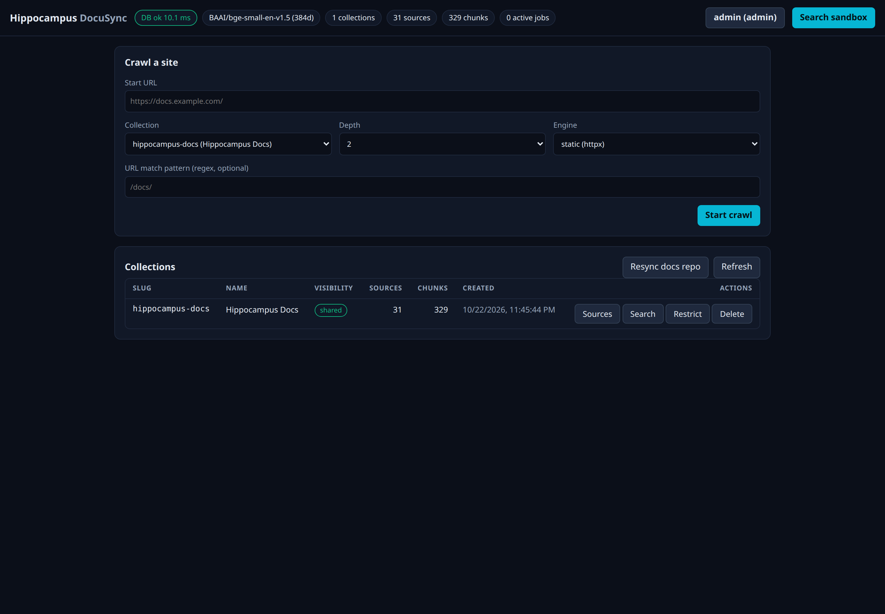
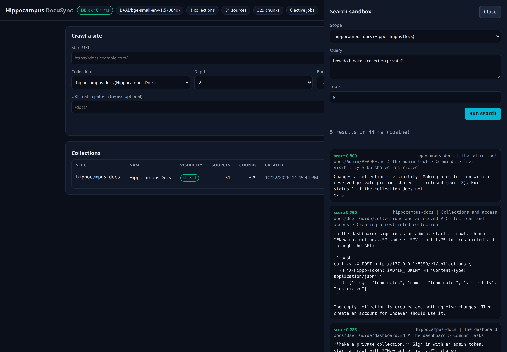
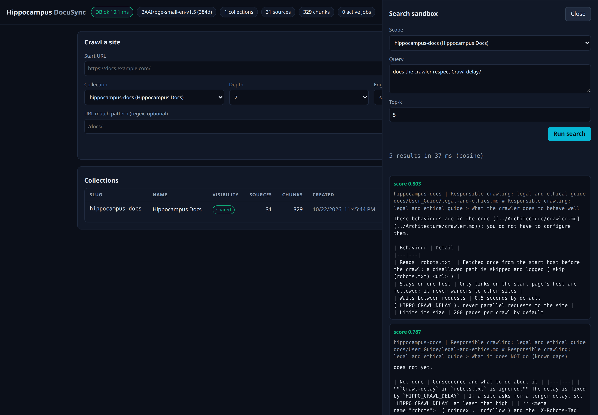
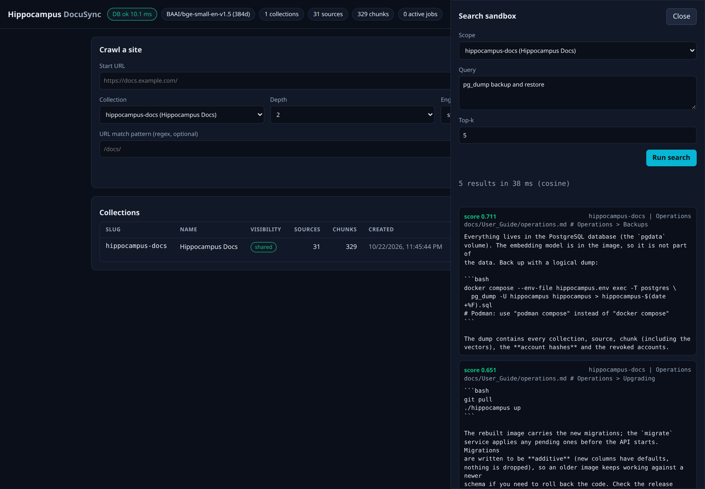
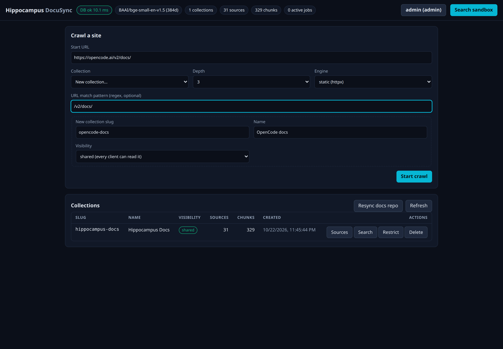
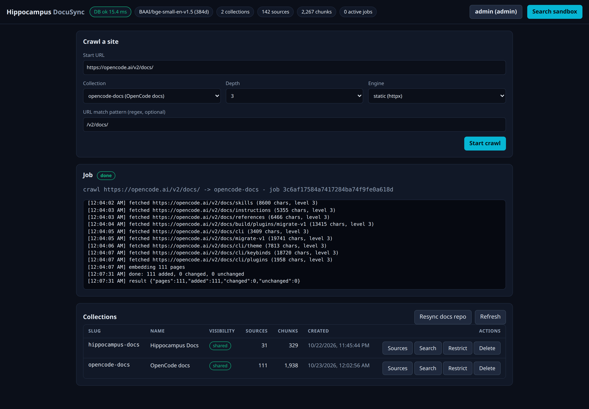
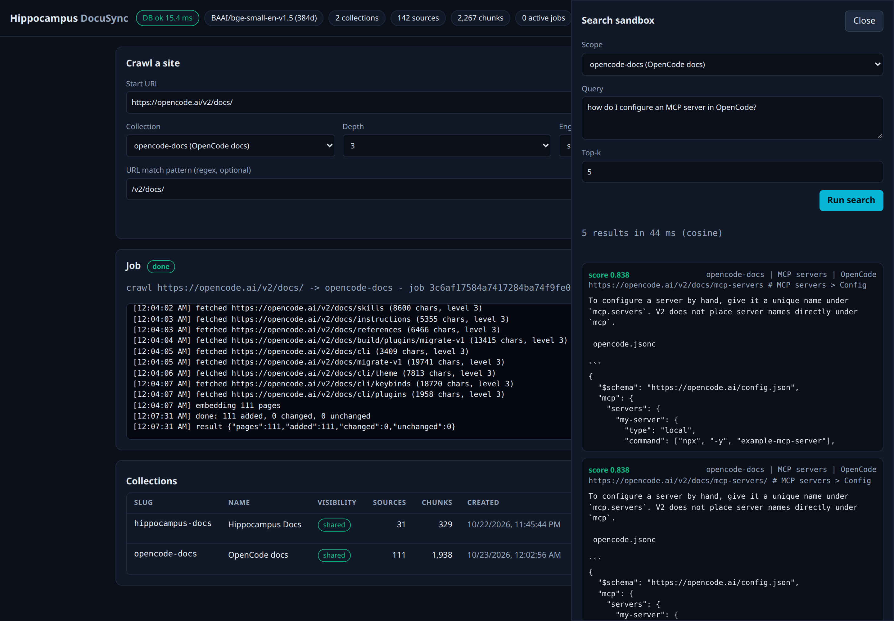
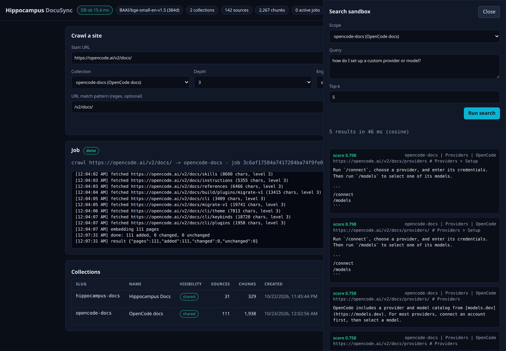
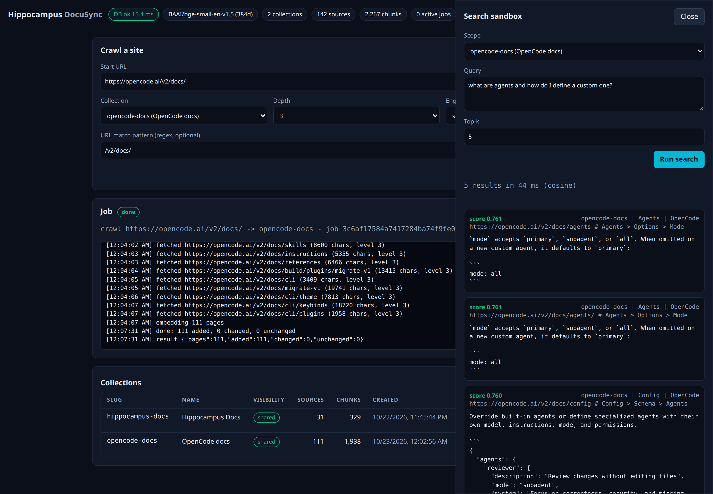

# Worked example: index the docs, crawl a site, ask questions

A start-to-finish run with screenshots of the dashboard: index this documentation into Hippocampus, crawl a public documentation site, and search both. It was run on a fresh
local stack (`./hippocampus up`) with the steps from the README. The screenshots show real results from that run; scores and timings will differ a little on your machine.

This is a living document. It describes the code as of migration `0002_access_control`; update it alongside the source.

## 1. Index the documentation

With the stack running and an admin token in `HIPPO_TOKEN`:

```bash
scripts/index_docs.py --plan     # what would be indexed; sends nothing
scripts/index_docs.py            # 31 files added to the collection "hippocampus-docs"
```

Open <http://127.0.0.1:8090/ui/>, click `anonymous` in the header and paste the token. The header pills now show one collection, 31 sources and 329 chunks, and
the Collections table lists `hippocampus-docs`.



## 2. Ask questions of the docs

Open the **Search** tab, choose the collection, type a question as a sentence and press **Run search**. Each result shows its score, the collection, the source,
the heading path of the passage and the text.

**"how do I make a collection private?"** finds the admin command that changes visibility, then the guide's section on creating a restricted collection:



**"does the crawler respect Crawl-delay?"** lands on the legal and ethics guide and the crawler page. Both say it does not honour `Crawl-delay` yet:



**"pg_dump backup and restore"** finds the Backups section of the operations guide first:



Search is by meaning, but the words you choose still matter. The plain question "how do I back up the database?" ranked other pages above the Backups section; naming
the tool (`pg_dump`) put it first. If a question finds nothing useful, try the words the page would use, or a longer sentence ([searching.md](searching.md#asking-good-questions)).

## 3. Crawl a documentation site

Before you crawl any site, read [legal-and-ethics.md](legal-and-ethics.md). This example crawls the public OpenCode documentation, whose `robots.txt` allows it.

In **Crawl a site**: enter the start URL `https://opencode.ai/v2/docs/`, choose **New collection...** and give it the slug `opencode-docs`, set the depth to 3, and set the URL
match pattern to `/v2/docs/` so the crawl stays inside the documentation.



Press **Start crawl**. The job log streams each page as it is fetched and then embeds them. In this run it fetched 111 pages (the crawler waits half a second between requests), then spent about three
and a half minutes embedding them on the CPU (the dashboard keeps working meanwhile):



## 4. Ask questions of the crawled site

Choose the new collection in the Search sandbox scope. **"how do I configure an MCP server in OpenCode?"** finds the page that explains it, with the configuration example:



**"how do I set up a custom provider or model?"** finds the Providers page (the `/connect` and `/models` commands):



**"what are agents and how do I define a custom one?"** finds the Agents page, then the config and permissions pages:



## Things this run showed

- **Duplicate pages.** The same page was stored twice when the site links to it both with and without a trailing slash (`/v2/docs/providers` and `/v2/docs/providers/`),
  so the 111 pages include many duplicates and results often appear in pairs with identical scores. It is harmless to answers but wastes space and embedding time. The
  fix is to treat the two spellings as one URL in the crawler.
- **Wording matters.** See the backup example above.
- **Pages from third-party sites** are stored as copies. Keep to the checklist in [legal-and-ethics.md](legal-and-ethics.md), and delete the collection when you no longer need it
  (Collections table, **Delete**).

To remove the example data: `./hippocampus down` keeps it, `./hippocampus reset` deletes everything.
